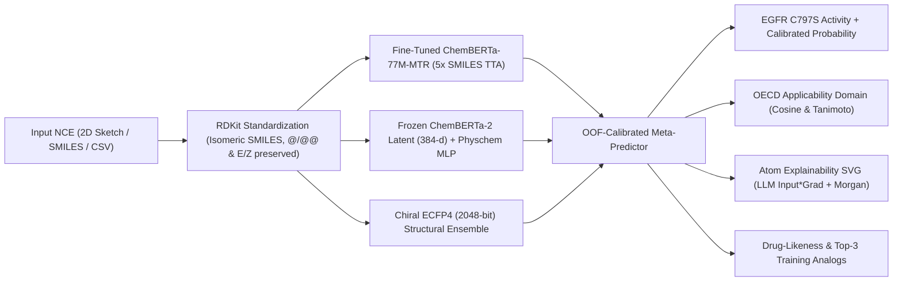

# EGFR C797S ChemBERTa-2 LLM Pipeline & NCE Screening Web App

> [!IMPORTANT]
> **Active Workspace Recommendation:** Set [egfr_c797s_qsar_llm](file:///C:/Users/owner/.gemini/antigravity/scratch/egfr_c797s_qsar_llm) as your active workspace in Antigravity to browse, run, or extend the trained models and web application directly.

---

## 1. Pipeline Architecture



### Core Modules
- [chemistry.py](file:///C:/Users/owner/.gemini/antigravity/scratch/egfr_c797s_qsar_llm/src/chemistry.py) — Salt stripping, canonical **isomeric** SMILES standardization, SMILES enumeration (`doRandom=True`), chirality-aware `ECFP4` (`2048-bit`), Lipinski/Veber/QED profiling, EGFR SMARTS motif detection, and 2D atom attribution SVG rendering.
- [train_pipeline.py](file:///C:/Users/owner/.gemini/antigravity/scratch/egfr_c797s_qsar_llm/src/train_pipeline.py) — Leakage audit, 5-fold stratified cross-validation, end-to-end CPU fine-tuning of `DeepChem/ChemBERTa-77M-MTR`, out-of-fold threshold calibration, locked external test evaluation, 20-run Y-randomization, and Applicability Domain calibration.
- [predictor.py](file:///C:/Users/owner/.gemini/antigravity/scratch/egfr_c797s_qsar_llm/src/predictor.py) — Offline CPU inference engine combining `ChemBERTa-2 Input × Gradient` token attributions with Morgan circular environment sensitivity.
- [app.py](file:///C:/Users/owner/.gemini/antigravity/scratch/egfr_c797s_qsar_llm/app.py) & [index.html](file:///C:/Users/owner/.gemini/antigravity/scratch/egfr_c797s_qsar_llm/templates/index.html) — FastAPI backend and 3-tab NCE Screening Studio interface.

---

## 2. Dataset Audit & OECD QSAR Validation Results

- **Training Set ([Train.csv](file:///C:/Users/owner/.gemini/antigravity/scratch/egfr_c797s_qsar_llm/data/Train.csv)):** `222` compounds (`141` Active, `81` Inactive; `103` unique Murcko scaffolds).
- **External Validation Set ([Test.csv](file:///C:/Users/owner/.gemini/antigravity/scratch/egfr_c797s_qsar_llm/data/Test.csv)):** `148` compounds (`99` Active, `49` Inactive; `78` unique Murcko scaffolds).
- **Stereo-InChIKey Overlap (Train vs. Test):** `0` exact duplicates (zero data leakage).

### 5-Fold Stratified CV (`Train.csv`, `N = 222`) vs. Locked External Validation (`Test.csv`, `N = 148`)

| Model | 5-Fold CV ROC-AUC | 5-Fold CV MCC | External ROC-AUC | External PR-AUC | External MCC | Balanced Acc | Sensitivity | Specificity |
| :--- | :---: | :---: | :---: | :---: | :---: | :---: | :---: | :---: |
| **ECFP4 + RF (Classical Baseline)** | 0.9193 | 0.7488 | **0.9106** | **0.9416** | **0.6250** | 0.8015 | 0.9091 | 0.6939 |
| **ChemBERTa-2 (Frozen Embeddings)** | 0.8756 | 0.6220 | 0.8149 | 0.8755 | 0.4927 | 0.7510 | 0.8081 | 0.6939 |
| **ChemBERTa-2 (End-to-End Fine-Tuned LLM)** | 0.8619 | 0.6156 | 0.8644 | 0.9246 | 0.6167 | **0.8067** | 0.8788 | **0.7347** |
| **Hybrid ChemBERTa-2 + Chiral ECFP4** | 0.9083 | 0.7452 | 0.9025 | 0.9353 | 0.6221 | 0.7809 | **0.9495** | 0.6122 |

> [!TIP]
> **Key Scientific Takeaway for Publication:** End-to-end fine-tuning of `ChemBERTa-77M-MTR` with SMILES enumeration improved external test ROC-AUC from **0.8149 -> 0.8644** (+5.0%), MCC from **0.4927 -> 0.6167**, and achieved the **highest external Specificity (0.7347)** and **Balanced Accuracy (0.8067)** of all models. Combining it with chirality-aware `ECFP4` in the Hybrid ensemble maximizes active hit recall (**Sensitivity = 95.0%**, catching 94 of 99 active inhibitors in `Test.csv`), while within the strict **Applicability Domain (97.3% coverage)** the Hybrid model reaches **ROC-AUC = 0.9077** and **MCC = 0.6414**.

### Diagnostic Figures

````carousel

<!-- slide -->

<!-- slide -->

<!-- slide -->

````

### Robustness Checks
- **OECD Y-Randomization (20 Permutations):** Mean scrambled ROC-AUC = `0.5001 ± 0.0420`, Mean scrambled MCC = `0.0078`, **$cR_p^2 = 0.5424$** (passes the $> 0.50$ OECD non-chance correlation criterion).
- **Full External Predictions Table:** Saved at [external_test_predictions.csv](file:///C:/Users/owner/.gemini/antigravity/scratch/egfr_c797s_qsar_llm/reports/external_test_predictions.csv) and [metrics_summary.json](file:///C:/Users/owner/.gemini/antigravity/scratch/egfr_c797s_qsar_llm/reports/metrics_summary.json).

---

## 3. Streamlit Deployment Package & Complete Folder Manifest

A clean, self-contained deployment folder (free of virtual environments or Python version-locked `.joblib` files) has been assembled at:
- **Ready-to-Push Folder:** [streamlit_cloud_bundle](file:///C:/Users/owner/.gemini/antigravity/scratch/egfr_c797s_qsar_llm/streamlit_cloud_bundle)
- **Single-File ZIP Archive:** [EGFR_C797S_Streamlit_Deploy.zip](file:///C:/Users/owner/.gemini/antigravity/scratch/egfr_c797s_qsar_llm/EGFR_C797S_Streamlit_Deploy.zip)

### Deployment Folder Structure
- [streamlit_app.py](file:///C:/Users/owner/.gemini/antigravity/scratch/egfr_c797s_qsar_llm/streamlit_app.py) — Main Streamlit app (Single NCE Predictor + optional Ketcher 2D Sketcher, Batch CSV Virtual Screening, and OECD Validation Viewer).
- [requirements.txt](file:///C:/Users/owner/.gemini/antigravity/scratch/egfr_c797s_qsar_llm/requirements.txt) — Uses `--extra-index-url https://download.pytorch.org/whl/cpu` so Streamlit Cloud installs lightweight CPU PyTorch instead of a 2.5 GB CUDA wheel.
- [packages.txt](file:///C:/Users/owner/.gemini/antigravity/scratch/egfr_c797s_qsar_llm/packages.txt) & [runtime.txt](file:///C:/Users/owner/.gemini/antigravity/scratch/egfr_c797s_qsar_llm/runtime.txt) — Configures Debian `libxrender1`/`libxext6` for RDKit SVG rendering and pins `python-3.12` on Streamlit Community Cloud.
- [config.toml](file:///C:/Users/owner/.gemini/antigravity/scratch/egfr_c797s_qsar_llm/.streamlit/config.toml) — Custom UI theme and upload configuration.
- `models/production/` — Fine-tuned `ChemBERTa-77M-MTR` (`safetensors`, `13.1 MB`) + cross-version NumPy model state (`portable_state.npz` & `portable_meta.json`), ensuring compatibility across any cloud `scikit-learn` version and staying well under GitHub's `25 MB` file limit.
- `reports/` — [metrics_summary.json](file:///C:/Users/owner/.gemini/antigravity/scratch/egfr_c797s_qsar_llm/reports/metrics_summary.json), [external_test_predictions.csv](file:///C:/Users/owner/.gemini/antigravity/scratch/egfr_c797s_qsar_llm/reports/external_test_predictions.csv), and all 4 validation PNG plots in `reports/figures/`.

### Step-by-Step Deployment to Streamlit Community Cloud
1. Create a new GitHub repository and upload everything inside [streamlit_cloud_bundle](file:///C:/Users/owner/.gemini/antigravity/scratch/egfr_c797s_qsar_llm/streamlit_cloud_bundle) to the repository root:
   ```powershell
   cd C:\Users\owner\.gemini\antigravity\scratch\egfr_c797s_qsar_llm\streamlit_cloud_bundle
   git init
   git add .
   git commit -m "Deploy EGFR C797S ChemBERTa-2 NCE Predictor"
   git branch -M main
   git remote add origin https://github.com/<your-username>/<your-repo>.git
   git push -u origin main
   ```
2. Open https://share.streamlit.io -> **Create app** -> choose your repository, branch `main`, and set **Main file path** to `streamlit_app.py` -> click **Deploy**.
3. **Local Alternative:** You can also continue using the zero-extra-install local FastAPI launcher [run_webapp.bat](file:///C:/Users/owner/.gemini/antigravity/scratch/egfr_c797s_qsar_llm/run_webapp.bat) or run `streamlit run streamlit_app.py` after `pip install streamlit streamlit-ketcher`.
